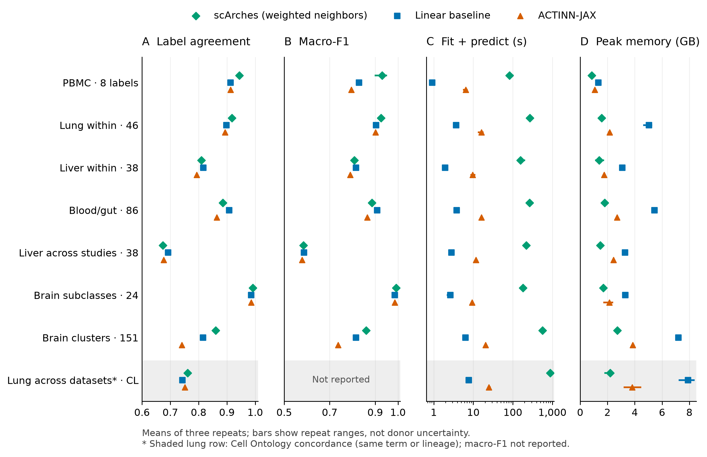
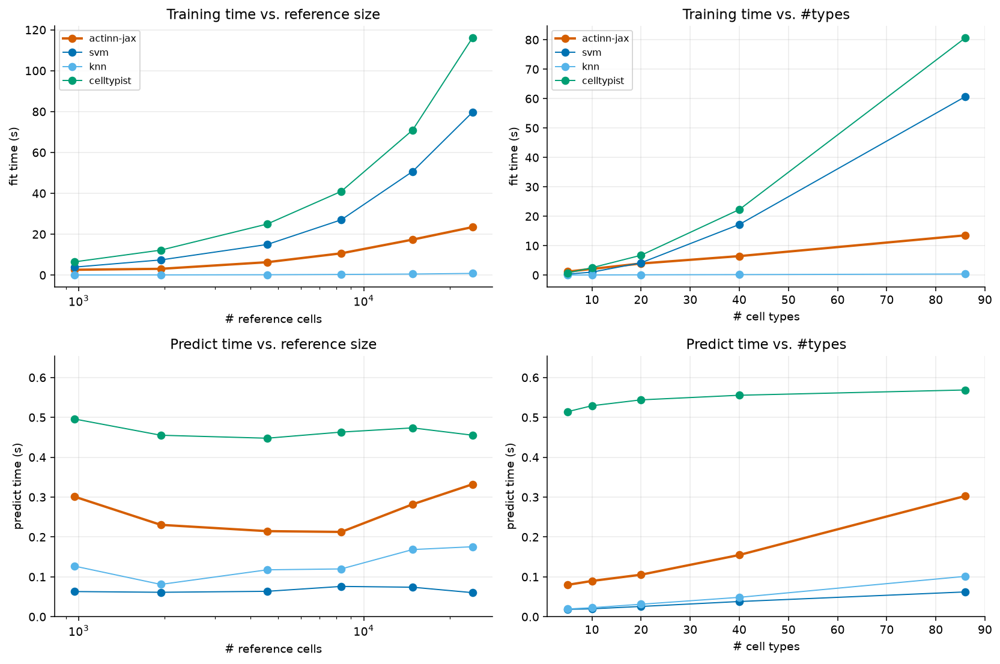
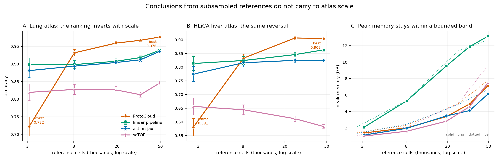
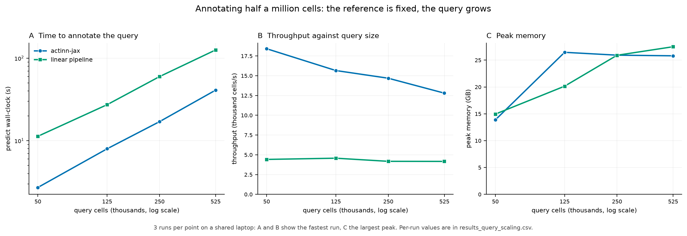
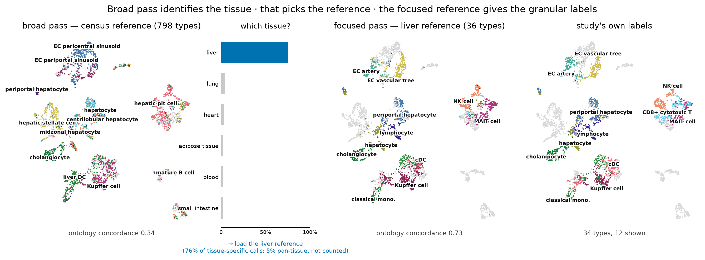
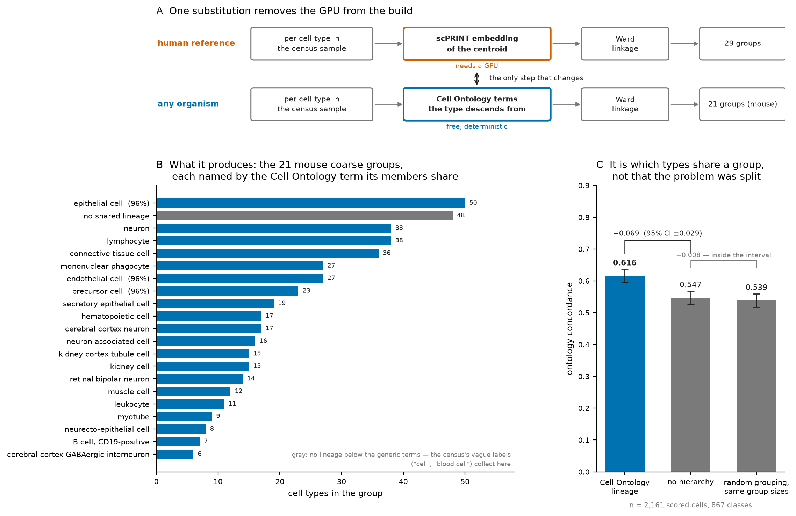
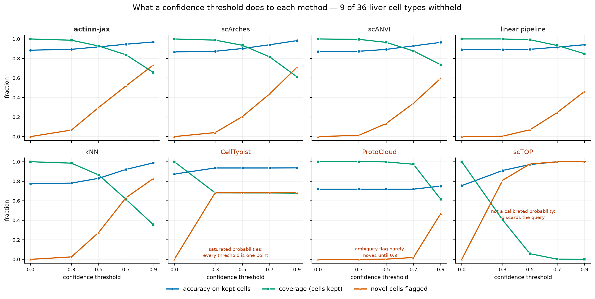
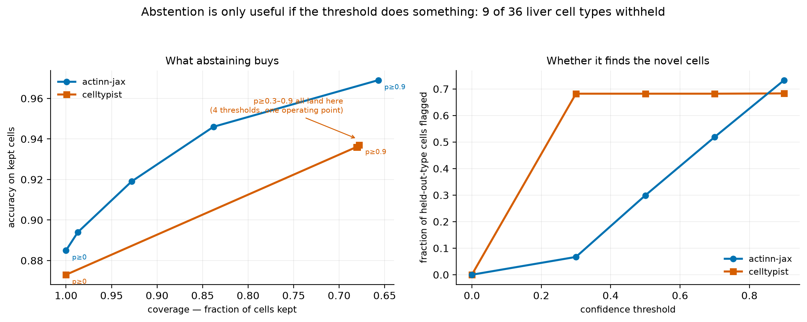
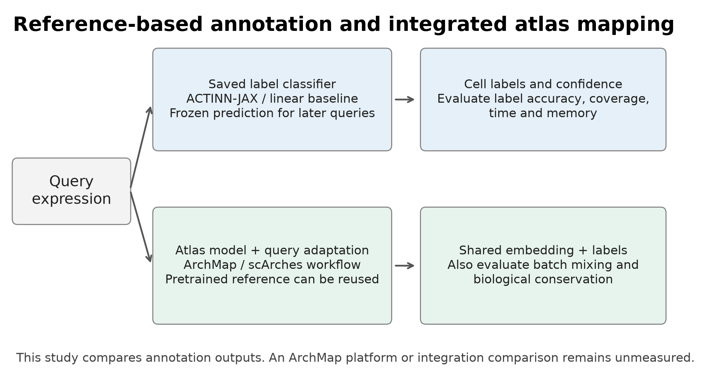

# Accuracy and computational cost of reference-based cell-type annotation on commodity hardware

*In-repo benchmark report. Numbers are generated by `configs/paper.yaml` and
`configs/paper_scprint.yaml` (results in `results/paper/`), the scaling experiment
(`benchmark/explore/scaling_experiment.py`), and the rejection experiment; figures by
`benchmark/explore/make_figures.py`. This report is regenerated from those artifacts, not
hand-entered.*

> **Scope:** eleven reference-trained methods run the eight in-house splits on shared
> reference and query partitions. Two pretrained annotators are evaluated where their label
> vocabularies permit comparison. Open Problems supplies an additional benchmark design;
> its runs were executed by us. Supporting protocols and recorded results are in this repository.

## Abstract

Reference-based cell-type annotation requires a choice of label resolution, reference and computational budget. We compared eleven reference-trained methods across eight splits of seven human datasets and evaluated two pretrained annotators where their vocabularies permitted comparison. We also used the Open Problems label-projection workflow. A matched comparison evaluated scArches with weighted-neighbor label transfer, a linear baseline and actinn-jax on identical query cells within eight splits. scArches gave the highest accuracy among these methods on PBMC, within-dataset lung and both brain tasks; the linear baseline led on liver and blood/gut. At 151 brain clusters, scArches scored 0.860 versus 0.816 for the linear baseline and 0.741 for actinn-jax, with complete-job times of 563, 6.3 and 20.4 s. scArches used less peak memory than either baseline. A saved actinn-jax reference annotated 524,699 cells in 31 s on the tested laptop. A focused liver reference improved ontology concordance from 0.580 to 0.858 on a study excluded from focused training. Distillation increased throughput with losses on withheld atlases; agreement identified higher-concordance subsets but did not improve the tested consensus over the best annotator. Our findings support ArchMap's emphasis on reference quality and uncertainty inspection. Unknown-cell percentage alone does not establish annotation accuracy. Label prediction and integrated atlas mapping require different evaluations; we did not assess ArchMap's integration quality or hosted performance. Code and pretrained references are publicly available.

## 1. Introduction

Reference-based annotation assigns labels to new single-cell RNA-seq data using a labeled
reference or a pretrained model. Previous comparisons measured annotation accuracy
[Abdelaal 2019], [Fu 2024]. Analysts also need to know the label resolution a method can
support and the time and memory needed for the intended workload.

ArchMap [Lotfollahi et al. 2026] combines scArches query adaptation with label transfer,
uncertainty scores and interactive inspection of published or custom atlases. It produces
a shared reference-query embedding as well as labels. Pan-human Azimuth [Sarkar et al. 2026]
supplies a pretrained hierarchical human annotator. We share their motivation to make
reference-based analysis accessible. Our measurements address annotation accuracy and
resource use, which are only part of an integrated mapping workflow.

We introduce actinn-jax, a JAX implementation of ACTINN [Ma & Pellegrini 2020] with sparse
preprocessing, saved references and chunked prediction. We compare eleven methods across
human datasets and evaluate scArches with weighted-neighbor label transfer against two
baselines on matched query cohorts. We separate reference fitting and query adaptation from
prediction using saved models. Focused-reference, distillation and agreement studies examine
how reference choice and repeated annotation affect the result.

The central question is which computation is justified by the required output. A cell-label
task can use a frozen classifier; placing cells in a shared atlas embedding additionally
requires evaluation of batch mixing and biological conservation. We measure the former.
We also test confidence-based screening, where coverage and errors must be considered
together. These distinctions define where our findings support or qualify interpretations
of the ArchMap paper.

## 2. Methods

### 2.1 actinn-jax

actinn-jax reimplements ACTINN ([Ma & Pellegrini 2020]), a 4-layer fully-connected network
(100/50/25 hidden units, ReLU, softmax) trained with Adam, in JAX and optax ([Bradbury 2018]), replacing the original's TensorFlow-1.x graph and session code. The implementation provides the following features:

- Preprocessing never densifies the count matrix in full. CP10k and log2 normalization and
 the expression and coefficient-of-variation gene filter run on the sparse matrix, and only
 the selected-gene columns of each minibatch are made dense.
- A trained reference is written to disk and reloaded to map many queries, so the amortized
 cost of repeated annotation against a fixed reference falls to the inference cost alone.
- Prediction is chunked for atlas-scale queries, and raw counts are picked up automatically
 from the slot where CELLxGENE files conventionally store them.
- Reference-fit standardization is available: z-score each selected gene by the reference's
 frozen mean and standard deviation and apply that to the query, a cheap domain alignment
 (§3.3). It is off by default. When on, the scaler is saved alongside the model and travels
 with it, and models saved without it still load.

The original-model comparison found similar accuracy on the tested splits. The JAX
implementation targets current Python environments and efficient prediction. We omit the
original from the main comparison and provide its separate results in the repository.

### 2.2 Benchmarked methods

| method | source | tier | engine | rejection | runtime |
|-----------|------------|-----------|--------------------|----------|------------|
| **actinn-jax** | [Ma & Pellegrini 2020] | classical | JAX MLP | confidence threshold | JAX |
| SVM | [Pedregosa 2011] | classical | linear SVM (SGD) | none | scikit-learn |
| kNN | [Pedregosa 2011] | classical | k-nearest neighbors | none | scikit-learn |
| CellTypist | [Domínguez Conde 2022] | linear | L2 logistic regression | prob threshold | scikit-learn |
| **linear-anova-pca** | [Pedregosa 2011] † | linear | normalize, ANOVA, PCA(220), logreg | prob | scikit-learn |
| **scTOP** | [Yampolskaya 2023] | parameter-free | rank z-score class-average projection | none | NumPy |
| SingleR | [Aran 2019] | correlation | Spearman + fine-tuning | none | R |
| scmap-cluster | [Kiselev 2018] | correlation | centroid cosine | yes (unassigned) | R |
| scANVI | [Xu 2021] | deep | scVI semi-supervised VAE | prob | scVI |
| scArches | [Lotfollahi 2022] | deep | scANVI reference surgery | prob | scVI |
| **ProtoCloud** | [Guo & Ding 2026] | deep | prototype VAE + LRP attribution | ambiguity flag | PyTorch |
| scPRINT | [Kalfon 2025] | foundation | pretrained transformer, zero-shot | none | PyTorch |
| **Pan-human Azimuth** | [Sarkar et al. 2026] | pretrained | 8-level hierarchical NN, fixed 382-leaf typology | trained `Unassigned` | TensorFlow |

**Table 1.** The benchmarked methods: model family (*tier*), the engine each one actually runs,
whether it can decline to call a cell (*rejection*), and the runtime stack it was run on;
each has its own pinned environment (§2.5). Bold marks the methods added to this panel here.

† `linear-anova-pca` implements the Souza and Mehta pipeline [Souza & Mehta 2026] with
reference-fitted normalization, ANOVA selection, standardization, PCA and logistic regression.
The adapter uses up to 20,000 selected genes, 220 PCs and C = 1.0. We did not apply equal
hyperparameter-search budgets across methods; SVM, kNN and CellTypist use untuned settings.

Eleven of the thirteen are trained on each dataset's own reference and run the full accuracy
and cost matrix of §3.1 on all eight splits. The remaining two are pretrained annotators with fixed label vocabularies, so their
coverage and scoring differ.

scPRINT is a zero-shot foundation model over a fixed Cell Ontology (CL) vocabulary. CL is the
standard controlled vocabulary of cell types, used throughout as the common ground between
datasets that name the same cell differently. scPRINT cannot emit labels outside that set,
and skips symbol-keyed datasets.

Pan-human Azimuth ([Sarkar et al. 2026]) is a supervised hierarchical classifier over a
single organism-wide typology: 8 levels, 382 leaves, about 7M parameters, a fixed 5,055-gene
panel, trained on 9.7M curated cells. Its abstention is learned rather than thresholded, in
that the model is trained to answer `Unassigned` instead of having a probability cutoff
applied to its output afterwards. It is the closest published counterpart to this paper's
broad pass, and the teacher we distill in §3.5.

Neither predicts into the dataset's label strings, so exact-match accuracy against those
strings measures vocabulary rather than accuracy. Reading `regulatory T cell` as `Treg cell`,
or `non-classical monocyte` as `CD16 monocyte`, can be a biologically compatible answer that scores zero. We
therefore score both ontology-only (§2.4) and report them in their own block in §3.2, on the
three datasets where reference and query both carry Cell Ontology ids. They appear again in
§3.2, as pretrained annotators, and in §3.5, where Azimuth serves as broad pass and as
distillation teacher.

scPred was excluded because we could not install it with the harmony dependency versions
used for this benchmark.

### 2.3 Datasets

| dataset | source | split | tissue | #types | genes | notes |
|-------------|----------|-------|-----------|------|-------|-----------|
| lung_intra | [Travaglini 2020] | within-dataset | lung (Krasnow) | 46 | Ensembl | 300 cells/type ref |
| lung_cross | [Sikkema 2023] to [Travaglini 2020] | cross-dataset | lung (HLCA to Krasnow) | 46 | Ensembl | query study present in the reference; see below |
| liver_intra | [Edgar 2026] | within-dataset | liver (HLiCA) | 36 | Ensembl | 150 cells/type |
| liver_cross | [Edgar 2026] | cross-**study** | liver (HLiCA) | 34 | Ensembl | train 6 studies, test withheld study |
| blood_gut_intra | [Alegbe 2026] | within-dataset | blood + gut (IBDverse) | 86 | Ensembl | high cardinality; no CL ids |
| pbmc | [10x Genomics 2016] | within-dataset | PBMC (pbmc3k) | 8 | symbols | small-n; scPRINT skips (symbols) |
| brain_intra | [Jorstad 2023] | within-dataset | brain, MTG (Allen) | 24 | Ensembl | single nuclei; Allen subclasses |
| brain_cluster | [Jorstad 2023] | within-dataset | brain, MTG (Allen) | 151 | Ensembl | Allen source, CCN cell sets |

**Table 2.** The eight benchmark splits, over seven datasets. Brain appears twice because the
Allen taxonomy is scored at two resolutions on separately sampled inputs. *split* separates within-dataset
holdouts from cross-dataset and cross-study transfer; *genes* records whether the matrix is
keyed by Ensembl ids or by gene symbols, since a method or reference built on one convention
cannot read the other without remapping.

The lung cross-dataset split maps the HLCA onto Krasnow, and the HLCA integrates Krasnow
among its component studies: 60,982 of its cells carry the study label `Krasnow_2020`, which
is 92.9% of the Krasnow file. The split is therefore cross-dataset in label vocabulary but
not study-held-out. In the sampled split, 1,790 of 14,390 reference cells (12.4%) come from
`Krasnow_2020` and 840 of 13,550 query cells (6.2%) appear in the reference under their own
cell identifiers. What the split cannot support is a claim about generalization to an unseen study.

The blood and gut set is a subsample of IBDverse (Wellcome Sanger Institute; blood, terminal
ileum and rectum from 421 individuals), included because 86 fine-grained labels make it the
high-cardinality stress case for the panel. It carries no Cell Ontology ids, so it
contributes to accuracy and macro-F1 but to no ontology-scored result.

The brain set is single nuclei from the Allen Institute's human middle temporal gyrus
taxonomy [Jorstad 2023], the same query used in the multi-reference agreement experiment of
§3.5. It enters twice, at two levels of that taxonomy: `Subclass` (24 types, about 300 cells
each), the standard annotation level, and `Cluster` (151 types, about 100 cells each), whose
members are the cell sets `CCN201908210` enumerates. Only the 10x 3' v3 nuclei are kept
(141,782 of 156,285); the remaining Smart-seq v4 nuclei would put a full-length protocol on
one side of a within-dataset split.

Both levels are evaluated by exact match and macro-F1. In the dataset's supplied ontology
annotations, the five intratelencephalic subclasses (`L2/3 IT`, `L4 IT`, `L5 IT`, `L6 IT`,
`L6 IT Car3`) share `CL:4023040`; `Lamp5` and `Lamp5_Lhx6` share a term, as do `Sst` and
`Sst Chodl`. These annotations provide 18 terms for 24 subclasses and no distinct mapping
for the 151 clusters. This is a property of the dataset's crosswalk, not evidence that
Cell Ontology lacks the finer terms. Scoring with that crosswalk would credit some
subclass and cluster confusions, so brain is excluded from the reported ontology aggregates.
§3.5 uses the coarse crosswalk for a separate agreement analysis.

The set spans the three generalization regimes (within-dataset, across datasets, across
studies), more than an order of magnitude in cell-type count (8 to 151), five tissues (lung,
liver, blood, gut, brain), whole cells and single nuclei, and both gene-ID conventions.

### 2.4 Metrics

For each combination of dataset, method and repeat we record accuracy; macro-F1, unweighted
over classes so rare types count as much as common ones; ontology-aware concordance; fit
time; predict time; and peak memory, meaning peak resident set size, the maximum physical
memory the process held.

Ontology-aware concordance credits a call that is the same node, an ancestor, or a descendant
of the truth in the Cell Ontology. It exists because cell-type vocabularies disagree about
granularity more than about biology. Calling a `periportal region hepatocyte` a `Hepatocyte`
is right in lineage and wrong in depth; exact match scores it as a total failure. Concordance provides a shared scoring rule for different label vocabularies (§2.2), and we
report it only where both reference and query carry CL ids, so not on `blood_gut_intra` and
not on the symbol-keyed `pbmc`.

Concordance depends on the ontology release, since ancestor sets change between them. All
numbers here use the Cell Ontology basic release of 2026-06-08 (sha256 73996c63…), resolved
once and reused by every scoring pass. Scoring lung_cross against a later-fetched release
reproduces the splits exactly (14,390 reference and 13,550 query cells) and still moves
concordance by 0.003, with no model changing. Concordance measures compatibility within a lineage and can credit
an overly broad or overly specific call; it does not establish correct subtype resolution.
That release, its checksum, and pinned versions
for all six benchmark environments are recorded as lockfiles in the [benchmark repository][repo], which also carries a command that reports any drift from them.

Exact label accuracy and macro-F1 are reported for shared-vocabulary tasks. Lung across
datasets is scored by Cell Ontology concordance because the reference and query label
taxonomies differ. This score includes same-lineage labels at different depths and is
reported separately from exact-label metrics.

### 2.5 Harness, isolation, and hardware

Each method runs in its own virtual environment, as a separate process, because the
dependency sets are mutually unsatisfiable: scVI-based methods, TensorFlow and Keras
(Pan-human Azimuth), R (SingleR, scmap) and the JAX core cannot coexist in one interpreter.
One driver builds the reference and query split once per dataset from a fixed seed and hands
the identical pair to every method, so no method sees a different split. We use three
repeats of this fixed partition. These repeats measure optimization and runtime variation,
not variation across independently held-out donors or studies.
scPRINT and Pan-human Azimuth run once each, being deterministic given a fixed query and
dominated by a single forward pass.

Resource accounting is per subprocess. The adapter's `fit` and `predict` stages are timed
separately and peak resident memory is sampled in the child. Stage names do not imply equal
work: scANVI trains jointly on reference and query inside `predict`, and scArches adapts a
reference model to the query there. Their `predict` times include query-specific training;
the fitted classical classifiers perform inference in that stage. We therefore compare
fit plus predict for a complete annotation job and report the stage times to expose this
difference. Frozen-model inference requires a separate comparison.

Hardware is Apple Silicon (M-series): CPU for the classical, linear, correlation and
pretrained tiers and for actinn-jax, and Apple MPS for the deep and foundation tiers. The in-house
panel uses no discrete GPU or cloud hardware. Math-library
threads are left uncapped, so wall-clock is what a practitioner sees; an optional thread cap
exists for stricter reproducibility. §3.3 repeats the comparison on one cloud CPU instance,
where methods compete for cores, and §2.10 explains how that is handled.

### 2.6 Building a broad reference

The bundled broad-pass references (§3.5) are built once, offline, by a three-stage pipeline
driven by one command in the [benchmark repository][repo].

*Sampling.* We take every primary cell for one organism in the CELLxGENE Census [CZI Census 2025], primary meaning the copy the census designates canonical, so cells deposited in more
than one study are counted once. Cells are stratified by cell type at a fixed cap per type:
40 for `broad_human_v1`, 60 for the later human and mouse pulls. Types with fewer than 12
cells are dropped, as are labels that carry no information ("unknown", "native cell",
"eukaryotic cell", "animal cell"). The pull is checkpointed every ten datasets and retried,
since transient object-store read errors are routine at this scale. Genes are carried under
both Ensembl ids and symbols, because a symbol-keyed consumer cannot use an Ensembl-only
pull. The census "stable" alias is a moving pointer, so we record the release it resolved to;
every reference here comes from census 2025-11-08.

*Coarse hierarchy, by two routes.* The model is a coarse classifier over groups plus one fine
classifier per group, and the grouping comes from either of two sources.

1. Foundation-model embeddings. scPRINT (medium-v1.5) embeds the reference once in 4,000-cell
 chunks; per-cell-type centroids are Ward-clustered into roughly √(number of types) groups,
 with a floor of eight. scPRINT's QC drops cells, so the embedding is not positionally
 aligned to the input, and the label is carried through the model with the vectors. This is
 the only step that wants a GPU or MPS.

2. Cell Ontology lineage. Each cell type is described by a binary indicator over the CL terms
 it descends from. Terms appearing in fewer than two types, or in all of them, are dropped as
 uninformative, and the same Ward clustering is applied to those vectors. This route is deterministic and uses the same procedure for either organism, which is what makes the pan-mouse reference possible:
 the distillation teacher is human-only, and scPRINT's mouse support is untested here. §3.5
 scores this route against no hierarchy and against a random grouping.

*Training and calibration.* We select a 4,000-gene panel of highly variable genes on the
reference, meaning the genes that differ most across cells and so carry most of the signal
for telling types apart, and train the coarse and per-group fine models on it. Abstain
calibration holds out 10% of cell types entirely as out-of-distribution, meaning types the
model was never trained on, standing in for the novel populations a real query contains, plus
a 20% within-type test split. We sweep the confidence threshold to trade coverage against
accuracy on kept cells, which is the table each bundled reference reports.

*Provenance and verification.* Each reference carries a build record: census release, corpus
sizes, hierarchy route, organism and calibration table. Because a rebuild can train cleanly
and annotate worse, the previous reference is backed up and the new one is scored on a
held-out atlas before it is kept. For `broad_mouse_v1` the test set is carved from the census
itself: two datasets are excluded from the reference sample and re-pulled as the query, so
"held out" means held-out datasets and not merely held-out cells.

### 2.7 Distilling a pretrained annotator

A broad reference can also be built without labels and without a GPU, by taking both the label
vocabulary and the hierarchy from an existing pretrained annotator. Keras and TensorFlow
cannot share a process with JAX, so this runs in two stages.

*Teacher pass.* Pan-human Azimuth labels a corpus of raw counts through its low-level API in
batches of 8,192, which loads the weights once rather than once per call. All eight levels are
retained. Where the package cannot reconcile a refined level with its coarser ones it blanks
that column; those cells still carry a deepest-level call, so we fall back to it rather than
discard them, since dropping them would distill only the cells the teacher found easy.
Predictions are mapped to CL ids through the package's own crosswalk.

*Student pass.* The student is a hierarchical actinn-jax reference whose classes are the
teacher's refined fine labels, including its trained `Unassigned` quality-control class, and
whose hierarchy is the teacher's own broad level, so the coarse-to-fine structure is inherited
rather than rediscovered. We use a 4,000-gene HVG panel and drop classes with fewer than 8
cells, since a class that cannot be split into train and test makes fidelity depend on which
side its cells landed.

*Corpus.* Three local atlases (lung, liver, blood and gut) capped at 600 cells per label, plus
a census-wide pull of at most 60 per type. The atlases' own labels are used only for scoring,
never for training.

*Evaluation.* Two arms answer different questions. The in-corpus arm holds out a stratified
25% of cells and measures fidelity, meaning how often the student reproduces the teacher,
exactly and ontology-equivalently. The held-out atlas arm withholds an entire atlas and
measures whether the student generalizes to data the corpus never covered. Both arms also
score student and teacher against the atlases' own labels, which separates distillation loss
from teacher error. Once the census pull is in the corpus, a withheld atlas is no longer a
withheld tissue.

### 2.8 Refinement, abstention, and novelty

Four mechanisms operate on a trained reference at inference time without query truth labels.

- Confidence abstention. Cells whose final probability is below a threshold are relabeled
 "unknown" rather than forced to the nearest class. Calibrated per reference (§2.6).
- Refinement to the query. The reference's class set is masked to those classes the query's
 own predictions support, and the softmax is renormalized. No ground truth, no retraining.
- Refinement to a tissue. Classes are masked to those the census records in the given tissue,
 while pan-tissue types (immune, endothelial, stromal) stay available everywhere, so
 liver-resident T cells are unaffected. The per-class tissue map is baked into the bundled
 reference. The tissue is given explicitly or read from the query's own metadata, with common
 synonyms recognized (PBMC for blood, hepatic for liver). A tissue outside the reference's
 vocabulary imposes no filter rather than an empty one.
- Cluster-level novelty screen. A cell type absent from the reference may form a cluster of low-confidence cells. Clusters
 that are both large enough to be a real population and predominantly low-confidence are
 flagged, with marker genes reported for each. This screen proposes populations for inspection;
 low confidence can also reflect batch effects or poor cell quality. Marker expression and
 study-level replication are needed before assigning biological novelty.

The same machinery resolves structure below a cell-type label: a hepatocyte zonation model
trained on portal-to-central zone labels, scored by within-one-zone agreement across donors
and datasets.

### 2.9 Scaling protocol

A benchmark run at one reference size measures that size, not the method. We use separate designs for runtime and atlas-scale accuracy. The runtime sweep holds the
query fixed while varying reference size or label cardinality. The atlas-scale sweep caps
cells per type before a 25% query split, so both reference and query size change. Its curves
describe these changing samples and do not isolate reference size alone.

Each sweep answers a different question. Cost against size and cardinality (§3.4, Figure 2)
covers six reference sizes up to 24k cells and separately varies the number of cell types,
asking whether inference cost grows with either, which is the property the multi-stage
workflow depends on. Accuracy and memory to atlas scale covers five sizes up to 49k cells on
lung and four up to 47k on the HLiCA liver atlas (§3.4, Figure 3), describing how rankings change across increasingly large samples. A third sweep runs the other way, holding the reference
fixed and growing the query to a whole 525k-cell atlas (§3.4, Figure 4), which is the axis a
reused reference is actually pointed along.

Sizes are set by capping cells per type, which is why they are not round numbers. The lung
sweep's top point is the remaining atlas after its 25% query split. The liver atlas is far larger
at 525k cells, so its sweep stops at a matching reference size rather than at its own ceiling,
which is what lets the two be read against each other.

### 2.10 External validation protocol

Open Problems `label_projection` [Open Problems 2024] supplies the datasets, metrics and
ranking, none of them chosen by us. actinn-jax is packaged as a viash 0.9.7 component
declaring the normalization it expects, and run through the project's own Nextflow workflow.
We additionally built components for four baselines (linear-anova-pca, scTOP, SVM,
CellTypist) so the same-hardware comparison covers more than the leaderboard's own set.

The paper reports two environments. The in-house panel (§3.1 to §3.6) runs on the Apple
Silicon laptop described in §2.5. The Open Problems results (§3.3) run on AWS `r7i.8xlarge`
instances (32 vCPU, 247 GB) through OP's own Nextflow pipeline, two tasks at a time.

Accuracy in Table 6 comes from a single AWS run covering all eleven methods, so every score is
one harness, one machine, one invocation.

Cost is reported as a ratio to actinn-jax rather than in seconds, because wall-clock on a
shared box depends on what else is running. Measured `%cpu` spans 49% to 2338% across these
methods, and actinn-jax itself averaged 165 s per dataset when scheduled alongside OP's seven
and 87 s per dataset alongside our four. We report within-run ratios and include actinn-jax in both runs as an anchor. These ratios
remain sensitive to method-specific threading and co-scheduled work; the changed anchor
runtime shows that they are not an isolated measure of algorithmic cost. Peak resident
memory is reported as measured and can also be affected by paging under memory pressure.

### 2.11 Ablations

Three cheap interventions characterize when a gene-space MLP gains or loses against heavier
methods, all selectable without test labels.

- Input standardization: z-score each selected gene by the reference's frozen mean and
 standard deviation and apply that to the query, a reference-fitted input transformation. Opt-in,
 because it shifts the probability calibration the abstain thresholds are tuned against.
- Gene budget: Open Problems feeds every method 1,000 HVGs. We sweep wider panels and select
 per dataset by held-out reference cross-validation, which is label-free with respect to the
 test set.
- Protein-embedding featurization, as a negative control. A CPU-only featurization in the
 style of Universal Cell Embeddings (UCE) [Rosen 2026]: an expression-weighted mean of ESM2
 [Lin 2023] protein-language-model gene embeddings. It tests whether a foundation model's
 value survives a cheap pooling shortcut.

### Matched annotation comparison

scArches uses scANVI reference mapping, a 30-dimensional latent space, two hidden layers,
layer normalization and a batch covariate. Reference scVI and scANVI training use up to 200
and 100 epochs with early stopping, respectively. Query adaptation uses 100 fixed epochs;
labels are transferred by Gaussian-weighted voting among 15 reference neighbors. The
weighted-neighbor transfer and query-adaptation budget follow ArchMap [Lotfollahi et al. 2026]; reference training, atlas inputs and hardware are specific to this benchmark.
Supplementary Table S5 describes a faster native-head configuration used in the eleven-method
panel and screening experiments. It has a smaller training budget and is reported separately
from the weighted-neighbor comparator.

We evaluated scArches, ACTINN-JAX and linear-anova-pca on eight splits with three training
repeats per method (72 scored runs). Query cell IDs and truth labels are identical across
methods within each split. Accuracy and macro-F1 are calculated from saved predictions.
Lung cross-dataset transfer uses Cell Ontology concordance and is excluded from exact-label
accuracy and macro-F1 means. Repeats use fixed partitions and do not measure generalization
across donors or studies. Cohort definitions and the native-head sensitivity comparison
are in Supplementary Tables S5 and S6.

## 3. Results

The eleven-method panel includes scArches with its native classifier head. The matched
comparison in Figure 1 uses weighted-neighbor label transfer and the training settings
described in Methods.

Sections 3.1 to 3.3 measure methods: eleven trained annotators over eight splits, two
pretrained annotators on the splits where that comparison is possible, and a run of actinn-jax under the externally designed Open Problems label-projection protocol. §3.4 measures how those
costs move with reference size, query size and label cardinality. §3.5 builds references from
public corpora and hands a query from a broad pass to a tissue-specific one. §3.6 covers what
a confidence threshold does when a query contains types the reference does not.

### 3.1 Accuracy and cost across the panel

Accuracy and macro-F1 average the five shared-vocabulary non-brain splits. Lung across
datasets uses Cell Ontology concordance and is excluded from those aggregates. Ontology
concordance averages the four non-brain splits carrying ontology IDs; cost averages all
six non-brain splits (Table 3).

The two brain splits are excluded from these aggregates and reported per dataset in Table 4,
so differences in label resolution remain visible. Adding brain at subclass level raises every method by 0.024 to 0.043 and reorders
nothing. Adding both brain splits gives mean accuracies over seven shared-vocabulary splits of scANVI 0.857,
linear-anova-pca 0.857, scArches 0.853, CellTypist 0.848, actinn-jax 0.840, SVM 0.835,
ProtoCloud 0.817, SingleR 0.811, kNN 0.792, scTOP 0.775 and scmap-cluster 0.706, which moves
actinn-jax from fourth to fifth, behind CellTypist.

| method | acc (5) | macro-F1 (5) | ontology (4) | fit (s) | **predict (s)** | peak mem (MB) |
|----------|----:|----:|----:|----:|----:|----:|
| **linear-anova-pca** | **0.839** | 0.803 | 0.808 | **2.5** | **0.31** | 4341 |
| scANVI | 0.836 | **0.808** | **0.811** | 0.0* | 58.7 | 2079 |
| scArches (native head) | 0.831 | 0.802 | 0.807 | 37.9 | 11.9 | 1774 |
| **actinn-jax** | 0.831 | 0.785 | **0.811** | 10.3 | **0.24** | 2407 |
| CellTypist | 0.823 | 0.792 | 0.805 | 44.0 | **0.52** | 1569 |
| SVM | 0.806 | 0.774 | 0.794 | 40.5 | **0.06** | 1416 |
| **ProtoCloud** | 0.790 | 0.742 | 0.778 | 118.6 | 1.32 | 1888 |
| SingleR | 0.770 | 0.746 | 0.750 | 0.2 | 34.7 | 3623 |
| kNN | 0.769 | 0.712 | 0.768 | 0.3 | **0.14** | 1489 |
| **scTOP** | 0.739 | 0.711 | 0.703 | 0.9 | 0.98 | 1927 |
| scmap-cluster | 0.646 | 0.626 | 0.771 | 0.2 | 7.33 | 8637 |

**Table 3.** Accuracy and cost together, ordered by accuracy. Accuracy is the mean over the five
shared-vocabulary datasets, macro-F1 is the mean over the five shared-vocabulary non-brain datasets, ontology
concordance the mean over the four of those carrying Cell Ontology ids, and cost is the mean
per query. The two brain splits are reported per dataset in Table 4 instead (see above). Bold highlights selected values; method order follows mean accuracy.

*scANVI trains on reference and query in the predict stage; scArches also includes
query adaptation in predict. These columns are adapter-stage timings. Compare fit plus
predict for complete-job cost, and do not read their ratios as pure inference speedups.

Across the five shared-vocabulary non-brain splits, the top four mean accuracies span 0.008
and their peak memory spans a factor of 2.4. Three repeats on fixed partitions do not
establish equivalence: the largest per-split repeat ranges are 0.024 for scArches and 0.023
for SVM, but uncertainty in paired differences across donors and studies was not estimated.
The 58.7 s scANVI `predict` stage includes training, whereas actinn-jax's 0.24 s stage uses
a fitted model. Their mean complete-job times are 58.7 s and 10.54 s, respectively, using
the reported fit and predict columns. The roughly 250-fold stage-time ratio is therefore
not a comparison of frozen-model inference.

The linear pipeline is both the most accurate and the fastest to fit, and pays for it in
memory, 4341 against 2407 MB, because ANOVA and PCA densify a cells by genes matrix while
actinn-jax stays sparse. The atlas-scale lung run measures 6.1 against 13.2 GB at 49k reference cells (§3.4).
Both methods can reuse a fitted reference: the linear adapter retains its gene selection,
scaler, PCA and classifier and applies them to later queries. actinn-jax additionally
provides a saved reference artifact for reuse across processes. Persistence and annotation
cost should be assessed separately. ProtoCloud takes 119 s for CPU fitting and has lower accuracy on these sampled references; it has the highest accuracy on the largest atlas samples (§3.4).

Those four are the tuned linear pipeline (0.839), scANVI (0.836), scArches (0.831) and
actinn-jax (0.831), led by the linear pipeline rather than by a deep model. CellTypist (0.823)
sits just outside them. actinn-jax and scANVI share the best ontology-aware concordance at
0.811. ProtoCloud (0.790) and scTOP (0.739) sit below that cluster on these subsampled
references, on these inputs. ProtoCloud has higher accuracy on larger atlas samples (§3.4); scTOP was designed for small label sets. Per dataset:

| dataset | actinn-jax | best method (acc) |
|---|---|---|
| lung_intra (46 types) | 0.894 | ProtoCloud 0.932 |
| lung_cross (cross-dataset)† | 0.752 ontology | **ProtoCloud 0.791 ontology** |
| liver_intra (36 types) | 0.802 | linear-anova-pca 0.804 |
| liver_cross (cross-study) | **0.686 exact / 0.731 ontology** | actinn-jax |
| blood_gut (86 types) | 0.860 | linear-anova-pca 0.902 |
| pbmc (8 types) | 0.913 | scArches 0.929 |
| brain, subclass (24 types) | 0.986 | ProtoCloud 0.991 |
| brain, cluster (151 types)ठ| 0.741 | SingleR 0.845 |

**Table 4.** Per-dataset accuracy: actinn-jax against whichever method leads that dataset.
† Lung across datasets is scored by Cell Ontology concordance; other rows use exact label accuracy. ‡ the two brain rows are the two resolutions of the Allen taxonomy, sampled and split separately; see below. § this panel uses the native-head scArches configuration. The weighted-neighbor comparison
uses a separately sampled cohort (Table 10); scores across these panels are not paired.

In the eleven-method panel, ProtoCloud has the highest accuracy on three splits, the linear pipeline on two, and
actinn-jax, scArches and SingleR one apiece. actinn-jax leads the cross-study liver split,
a cross-study transfer task,
and is second on within-dataset liver. It trails on lung, on the 86-type blood and gut set (4.2
points behind the linear pipeline), and on small-n pbmc. Outside brain, the spread across the
leading methods on any one dataset is 1 to 4 points. scmap-cluster is the weakest on accuracy
and macro-F1 throughout (0.23 macro-F1 on liver_cross), though not on ontology concordance.

The brain splits use two resolutions of the Allen taxonomy, with different sampled inputs. In the eleven-method panel, at
Allen's 24 subclasses, ten of the eleven methods fall inside 0.017 of each other (0.974 to
0.991, with scmap-cluster alone below at 0.901) and no method moves more than 0.003 between
repeats, so repeat variation is small on that fixed partition. At 151 clusters, the eleven-method ranking changes. SingleR
leads at 0.845, having placed eighth of eleven overall; scmap-cluster, last everywhere else at
0.646, reaches 0.810; and actinn-jax falls to 0.741, tenth. The two correlation methods gain
where the trained classifiers lose.

We checked three explanations for that. Every method ran at the same defaults as on the other
six splits. Raising actinn-jax's 50 training epochs to 150 and then 400 moves it from 0.741 to
0.746 to 0.747, an accuracy increase of 0.006. Reference counts alone do not explain the deficit: this split gives 72 reference nuclei per class against 89 on blood and gut, where
actinn-jax scores 0.860. Cardinality and label construction remain possible explanations.
Cluster-level labels derive from clustering expression data, which may favor methods that
compare a query to a class profile. These checks do not isolate either cause. Methods also disagree about which
clusters are hard (Supplementary Figure S5): median best-minus-worst recall is 0.32 per class
and mean pairwise Spearman 0.61, concentrated in the graded `L2/3 IT`, `Sst` and `Vip`
families rather than in the rare classes.

† Lung across datasets uses Cell Ontology concordance. HLCA and Krasnow annotate cells
at different depths: a query labeled `macrophage` may receive the reference label `lung
macrophage`, and a query labeled `endothelial cell` may receive a vascular subtype.
Ontology concordance credits these lineage-related calls. It ranges from 0.67 to 0.79
across the eleven-method panel, with ProtoCloud highest, and provides a biological
comparison across the two taxonomies. It can also credit overly broad or specific calls,
so it does not establish accurate subtype resolution.

**Figure 1.** Annotation agreement and cost. A: exact accuracy on shared-vocabulary tasks;
Cell Ontology concordance for lung across datasets (shaded row). Concordance credits identical
terms or an ancestor–descendant relationship, rather than fine-type accuracy. B: macro-F1 on
shared-vocabulary tasks. C: fit-plus-predict time (log scale). D: peak process memory. Methods
share query cells within each row. Points and bars show means and ranges of three repeats,
not donor confidence intervals. ArchMap platform and integration quality were not evaluated.

In the eleven-method overview (Supplementary Figure S14), six methods sit within 0.035 of the per-split leader on average while spanning 2.5 s to 51 s,
and the full panel spans 0.4 s to 111 s. scANVI and the tuned linear pipeline are the closest
to the leader, at mean gap 0.012 and 0.013, with the linear pipeline leading two splits, and
one of them costs 47 s against the other's 2.5 s. kNN and scTOP are cheaper still, at 0.4 s and
1.8 s, and give up 0.078 and 0.094, so they hold a different corner of the frontier rather than
sitting inside it. actinn-jax sits mid-panel, at mean gap 0.030 and 10.0 s, leading the
cross-study liver split. What separates it is not on this plot but on the scaling axes of §3.4:
low prediction cost and lower measured memory than the linear pipeline during reference
fitting. Several other fitted models also have nearly flat prediction cost in this sweep.

Every method's spread across splits is larger than the distance between the leading methods.
scmap-cluster spans 0.035 to 0.451, SingleR 0.000 to 0.191, and actinn-jax 0.000 to 0.104. A
mean over a panel of datasets, including the one in Table 3, summarizes that spread with a
single number.

### 3.2 Pretrained annotators and zero-shot foundation models

The two methods with fixed label vocabularies (§2.2, §2.4) cannot appear in Table 3, since
they do not predict the dataset's label strings. We score them by ontology concordance on the
three datasets where reference and query both carry CL ids and share a vocabulary, with
actinn-jax on the same splits for reference:

| | lung_intra | liver_intra | liver_cross | predict (s) |
|---|---:|---:|---:|---:|
| actinn-jax (reference-trained) | **0.917** | **0.846** | **0.731** | 0.27-0.37 |
| Pan-human Azimuth (pretrained) | 0.700 | 0.521 | 0.408 | 2.2-3.4 |
| scPRINT (zero-shot) | 0.201 | n/a | n/a | 62.3 |

**Table 5.** Pretrained annotators, scored by ontology concordance only, on the three datasets
where reference and query both carry Cell Ontology ids and share a vocabulary, with reference-trained actinn-jax on
the same splits for scale. The two sides were trained on different information; see the text
below.

The two sides of this table were given different information. actinn-jax is trained on a
reference drawn from the same data and scored in its own vocabulary. Pan-human Azimuth answers in a different vocabulary, and is mapped into the query's
through the ontology. The observed concordance is 0.700 for the curated supervised annotator and 0.201 for the
zero-shot foundation head on lung. Their training corpora and label coverage differ, so the
comparison does not isolate model architecture. §3.5 uses Azimuth as a
broad pass in its own right and as a distillation teacher. Peak memory is indistinguishable
between actinn-jax and Azimuth, at 1.65 to 2.1 GB on every dataset.

We ran scPRINT zero-shot, with no training on the reference, as a reference point for the
"just use a foundation model" alternative. On the lung dataset it scored exact-match accuracy
0.029 and ontology concordance 0.201, taking 62 s for 2,694 query cells, against actinn-jax's
0.894 in 0.23 s. As a label predictor it is both slow, about 280 times actinn-jax, and weak.

We report it on lung alone because its fixed vocabulary cannot score the other datasets: the
liver and blood-and-gut sets contain Cell Ontology terms absent from its label set, and it
declines them rather than guessing. That is an inherent property of a zero-shot label head
rather than a defect, but it does mean the raw predictions are not a drop-in annotator. It is
why the two-stage workflow uses scPRINT's embeddings, which carry its learned structure, to
shape a small trained model, and never its zero-shot labels.

### 3.3 External validation: Open Problems `label_projection`

For evaluation under an externally designed protocol, we ran actinn-jax
through the community-standard [Open Problems](https://openproblems.bio/benchmarks/label_projection)
label-projection task, using their 6 datasets, splits and metrics, and slotted it into their
published v2.0.0 leaderboard.

On the published benchmark protocol, actinn-jax places 3rd of 17 on mean accuracy
(0.837) and 1st among all methods that complete every dataset. It beats its PCA-space `mlp`
sibling, and posts the best accuracy of any completing method on the hardest dataset
(tabula_sapiens, 160 types: 0.394 against mlp's 0.342). It is upper-mid on macro-F1 and not the
top method overall. scANVI with scArches surgery, and xgboost [Chen & Guestrin 2016], score
higher on the datasets they finish, though both fail to complete tabula_sapiens, which is why
they rank above actinn-jax only on a mean over the 5 easier datasets. The foundation models
again land at the bottom (scgpt_zeroshot 0.639, uce 0.131, the latter roughly the random-labels
control), reproducing §3.2 externally.

Means over the six datasets, every method through the same pipeline on one instance:

| method | mean acc | macro-F1 | cost | peak mem |
|--------------------|------:|------:|------:|--------:|
| mlp | 0.843 | 0.662 | 1.98× | 19.9 GB |
| **actinn-jax** | 0.836 | 0.663 | 1.00× | 21.0 GB |
| **linear-anova-pca** | 0.828 | 0.647 | 2.67× | 20.1 GB |
| **SVM (SGD)** | 0.816 | 0.652 | 6.07× | 20.1 GB |
| logistic_regression | 0.813 | **0.689** | **0.18×** | 20.0 GB |
| **CellTypist** | 0.810 | 0.643 | 7.62× | 20.1 GB |
| knn | 0.793 | 0.648 | **0.07×** | 19.5 GB |
| xgboost | 0.791 | 0.614 | 5.48× | 80.7 GB |
| cellmapper_linear | 0.776 | 0.553 | 0.35× | 31.5 GB |
| naive_bayes | 0.738 | 0.613 | 0.19× | 19.5 GB |
| **scTOP** | 0.581 | 0.462 | **0.16×** | 20.4 GB |

**Table 6.** All eleven methods on the six Open Problems datasets, ordered by accuracy. Bold
marks the five components we contributed. *cost* is per-dataset wall-clock relative to
actinn-jax (§2.10), for which 1.00× is roughly two minutes.

actinn-jax scores 0.836 versus 0.843 for its `mlp` sibling at about half the measured cost, and beats xgboost on
accuracy at 5.5 times less runtime and 4 times less memory (21 against 81 GB). Everything
cheaper, meaning knn, logistic_regression, naive_bayes and scTOP, is less accurate, and the one
heavyweight is slower and heavier. Nothing here beats it on accuracy and cost together.

The tuned linear pipeline loses its §3.1 advantage on both axes. It places third on accuracy
(0.828, behind `mlp` and actinn-jax), and where it fits 4.1 times faster than actinn-jax on the
in-house panel it costs 2.7 times more here. The panels differ in feature budget, datasets,
hardware and execution protocol. OP supplies 1,000 HVGs and times a complete annotation job;
both the linear pipeline and the MLP fit once within each job. These measurements do not
isolate the feature budget as the cause of the runtime reversal. CellTypist (7.6 times) and the
SGD-SVM (6.1 times) shift the same way. Neither a cost ranking nor an accuracy ranking survives
a change of feature budget, which is why settings and execution conditions accompany both panels.

`logistic_regression` places fifth on accuracy but first on macro-F1 (0.689), at the
second-lowest cost. Across datasets spanning 13 to 160 cell types, accuracy and macro-F1 do not
order the panel the same way.

scTOP collapses on two of the six and is weak on a third. Its mean of 0.581 is not a uniformly
weak result but 0.042 on tabula_sapiens, 0.124 on gtex_v9 and 0.495 on immune_cell_atlas
against 0.90 to 0.99 on the other three. Open Problems hands every method 1,000 HVGs, and
scTOP's rank projection needs genes expressed in an appreciable fraction of cells. After its
expression filter only 106 of 1,000 genes survive on gtex_v9 and 210 on tabula_sapiens, against
306 to 405 where it works. At that point some test cells retain no counts at all, 185 of 11,508
on gtex_v9, and cannot be placed; they are scored as wrong rather than dropped, so 0.124 is a
floor. This is the same limitation §3.1 reports from the other direction: scTOP is built for
small, low-cardinality problems, and a fixed 1,000-HVG budget over 53 and 160 types is neither.

Three cheap ablations, and their limits.

*Input standardization*, meaning z-scoring genes to the reference's frozen mean and standard
deviation, a CPU-only input transformation, lifts mean
accuracy by 0.2 and macro-F1 by 1.2 points, with the largest gains on batch-shifted datasets
(gtex macro-F1 up 7.9). It is off by default because it shifts the softmax calibration that the
two-stage abstain thresholds are tuned against.

*Gene budget.* OP feeds every method 1000 HVGs, which starves a gene-space MLP more than it
starves the others. Widening to about 5000 HVGs lifts accuracy on 4 of 6 datasets (immune and
gtex up 3 points) and there matches scANVI with scArches's full-config leaderboard accuracy
(immune 0.891 against 0.892) on CPU in minutes, showing that the input gene budget contributes to this gap. Different model and training
protocols remain confounded in this comparison. But more genes is not a universal win. It regresses
tabula_sapiens by about 10 points, on its 284-cell test batch across 160 fine types, consistent with reference-specific
features transferring poorly, and it saturates hypomap. Held-out reference cross-validation and a query-cells-per-class diagnostic identify
tabula_sapiens in this panel without using test labels. They motivate a selection rule,
but prospective validation on new datasets is needed (Supplementary
Figures S12 and S13).

*Negative control.* A CPU-only, UCE-style protein-embedding featurization, an
expression-weighted mean of ESM2 gene embeddings, does not help and hurts the hardest case. The result applies to this pooling construction; it does not establish which components
account for the performance of a trained foundation model.

### 3.4 Scaling: reference size, query size, memory

**Figure 2.** Training and prediction time as reference size and label count change, for six CPU methods. Prediction time changes little with reference size for fitted models. From 5 to 86 labels, ACTINN-JAX prediction time increases 3.1-fold and the linear baseline's 11.0-fold; both reach about 0.23 s. SVM and kNN predict faster on these inputs. scTOP's smallest-reference point includes a one-time import cost.

Fit time grows with reference size and with the number of cell types for all trained methods.
actinn-jax's fit goes from 2 s to 16 s to 22 s as the reference grows from 965 to 14.8k to 24k
cells, below CellTypist (7 s, 71 s, 109 s) and SVM (4 s, 46 s, 75 s) at every size in the
sweep, and above the tuned linear pipeline (1 s, 7 s, 12 s). kNN does no work at fit time
beyond storing the reference, so all of its cost lands on predict, where it is also the least
accurate method here.

On the other axis, predict stays sub-second for every method across the whole sweep, and the
first thing to say is that flatness in reference size does not distinguish anything. All six
move by 1.1 to 2.5 times while the reference grows twenty-five-fold, although prediction complexity can still depend on stored reference cells or class profiles
for methods such as kNN and scTOP. Cardinality is where they part.
actinn-jax rises 3.1 times from 5 to 86 types (0.074 to 0.228 s); the tuned linear pipeline
starts three times cheaper and rises 11.0 times (0.022 to 0.244 s), so the two arrive at the
same place; scTOP rises 10.5 times. Neither of the two cheapest is ours. SVM (0.016 to 0.055 s)
and kNN (0.018 to 0.100 s) predict faster than actinn-jax everywhere, and pay for it in
accuracy (Table 3).

What the cached reference buys is therefore not a uniquely flat predict but the right ratio: a
sub-second call recurring against a fit of 12 to 109 s that is paid once. That is the regime
that matters when one reference serves many queries, and it is what makes chaining several
annotation stages practical. The linear pipeline also reuses its fitted scaler, PCA and classifier, as do other fitted
methods in the panel. This sweep's own memory column
is process-cumulative and not a clean per-size measurement; the atlas sweep below and the
matrix of §3.1 both run each method in its own process, and are where the memory numbers come
from.

At atlas scale the ordering changes. The sweep above stops at 24k cells. Carrying four methods
to full atlas size, 49k reference cells on lung and 47k on the HLiCA liver atlas, changes the
accuracy ranking (Figure 3A, B). ProtoCloud goes from the weakest method at 3k cells (0.722
lung, 0.581 liver) to the strongest at full scale (0.976 and 0.905), clear of the linear
pipeline (0.939, 0.863) and actinn-jax (0.936, 0.824), in these runs. Query composition also changes with the cap, so the curves do not isolate
the effect of reference size.
scTOP gains little from scale on lung (0.819 to 0.846, barely outside its interval) and loses
ground on liver (0.657 to 0.583).

Peak memory grows for every method, but the spread stays bounded at about 2 times rather than
widening (Figure 3D). The linear pipeline is heaviest throughout, at 13.2 GB against
actinn-jax's 6.1 GB at 49k lung cells, a ratio of 2.15, and scTOP crosses over from lightest to
heaviest as its rank processing densifies (9.3 against 6.5 GB at 47k liver cells). Conclusions
drawn from subsampled references do not transfer to atlas scale, in either direction.

**Figure 3.** Accuracy and peak memory across increasingly large samples, four methods on
three tissues. *A:* lung, 3.1k to 49k reference cells. *B:* HLiCA liver, 2.7k to 47k.
*C:* Allen brain subclasses, 1.8k to 46k. *D:* peak memory for all three sweeps.
Each cap is followed by a 25% query split; query size and composition therefore change with
reference size. Error bars on *A* to *C* are approximate 95% binomial intervals treating
query cells as independent. Each point is one run; the intervals omit training variation
and donor or study dependence.

Annotating an atlas costs less than building one. The runtime sweep above holds the query fixed; the atlas accuracy sweeps change both
partitions. The reverse case is the one a user meets most often, a reference built once
and then pointed at everything, and it is where a flat inference profile should pay. Holding
the reference at 17,753 cells drawn from seven HLiCA studies and growing the query from 50k
cells to the entire 524,699-cell atlas, actinn-jax annotates the whole atlas in 31 s (Figure
4A). Accuracy on the withheld study is approximately 0.720 across the measured query sizes;
each subset is drawn from the same atlas. Nested query subsets need not have identical accuracy.

The tuned linear pipeline stays about twice as slow throughout, annotating the same atlas in
67 s, and the gap narrows as the query grows. actinn-jax gives up 21% of its rate across the
range, from 21,400 to 16,800 cells/s, against the linear pipeline's 10%, from 8,700 to 7,900
(Figure 4B). The advantage is 2.4 times at 50k cells and 2.1 times at the full atlas. It is the
cheaper method whose per-cell cost drifts upward, which is the opposite of what a
flat-inference argument predicts, so the claim this axis supports is a roughly twofold constant
factor rather than flatness. The nearly flat prediction curves in the runtime sweep hold along the reference axis,
which is a different axis from this one.

Which of the two is cheaper depends on how many cells are annotated at once. The two
measurements do not overlap, since every query in this sweep holds at least 50,000 cells and
every query in Table 3 at most 13,550, but the smaller-query runs suggest an ordering change near 2,500 cells. Those points also
change dataset and reference, so they do not locate a controlled query-size crossover:

| query cells | 657 | 1,332 | 2,563 | 2,694 | 3,396 | 13,550 | 50,000 | 524,699 |
|---|---:|---:|---:|---:|---:|---:|---:|---:|
| actinn-jax (s) | 0.083 | 0.141 | 0.232 | **0.183** | **0.204** | **0.566** | **2.34** | **31.3** |
| linear pipeline (s) | **0.049** | **0.095** | 0.223 | 0.209 | 0.258 | 1.049 | 5.72 | 66.8 |

On the smaller queries the linear pipeline is 1.5 to 1.7 times faster; on the larger queries actinn-jax is, by
1.2 times at 2,694 cells, 1.9 at 13,550 and 2.1 to 2.4 across the atlas sweep. Part of the
small-query end is one-time cost. Calling `predict` repeatedly on one liver_intra model and
query settles from 0.24 to 0.30 s on the first call to 0.12 to 0.13 s by the third
(`predict_overhead_probe.py`), so roughly 0.12 to 0.17 s is compilation and warm-up, about half
the first call at 1,332 cells and a tenth of it at 13,550. The harness times the first call,
which is what a one-shot annotation costs.

The large-query end has a different mechanism. actinn-jax's throughput rises with the query,
from 7,900 cells/s at 657 cells to 24,000 at 13,550, settling at 16,800 to 21,500 across the
atlas sweep. The linear pipeline holds 11,500 to 14,000 on the small queries and falls to 7,900
to 8,700 at atlas scale, because its dense feature block leaves cache: 20,000 genes over 1,332
cells is 107 MB, and the same 20,000 genes over a 50,000-cell block is 4 GB and bounded by
memory bandwidth. A benchmark reporting one query size cannot show any of this.

Peak memory does not separate them at all. Both land at 33.2 GB on the full atlas (Figure 4C),
because on this axis peak memory measures holding the query rather than running the method: at
the largest size, prediction added nothing measurable on top of the resident query for either.
A caller streaming from disk would pay less, and would pay it equally. The 2-fold memory band
reported above is likewise a reference-axis result and does not carry to this one. Only the
reference axis separates these methods on memory.

Two conditions of this measurement. Prediction in our linear adapter blocks the query into
50,000-cell chunks. Unblocked, it densifies 20,000 genes for the whole query at once, which
needs roughly 126 GB at the full atlas and does not complete on a 51 GB machine, a property of
the wrapper rather than of the recipe. Blocking leaves every prediction bit-identical, as verified by comparison of the blocked and unblocked outputs. Second, these are laptop numbers, so each point is the fastest of three runs. A
competing process can only add time, and stalls on this machine are large and sporadic rather
than small and Gaussian: one repeat turned a 50 s fit into 975 s, and no mean over three runs
would survive that. Peak memory takes the largest of three instead, since `ru_maxrss` counts
resident pages and therefore reports less than a run needed whenever the OS evicts under
pressure. Per-run values are released with the harness so the spread is inspectable rather than
summarised away.

**Figure 4.** Cost against query size, 50,000 to 524,699 cells, with the reference fixed at
17,753 cells. Table 3's queries are all smaller than the leftmost point here (657 to 13,550
cells), so the two do not overlap. *A:* wall-clock to annotate the query. *B:* throughput, which declines 21% for actinn-jax and
10% for the linear pipeline, narrowing the advantage from 2.4 times to 2.1. *C:* peak memory, which
does not distinguish them, since on this axis it measures holding the query, not running the method. Three
runs per point on a shared laptop: *A* and *B* report the fastest run, since contention can
only add time, and *C* the largest peak, since resident-set size understates a run that the OS
has partly evicted. Per-run values are in `results_query_scaling.csv`.

### 3.5 Building references, and the broad-to-focused workflow

actinn-jax is built around a two-pass workflow rather than a single classifier, matching how
annotation is actually done: get a broad call fast, then sharpen it where it matters. Because
every stage is a cached `ReferenceModel` with sub-second, memory-bounded inference (§3.1,
§3.4), the whole workflow runs on a laptop.

**Figure 5.** Broad and focused annotation of a held-out HLiCA liver study (3,396 cells), shown on the same embedding. The census model assigns 144 of its 798 labels (ontology concordance 0.34). Its tissue map assigns liver to 76% of tissue-specific calls. A 36-type liver reference trained on the other six studies reaches concordance 0.73. The final panel shows study labels on the same palette. The focused reference has a verified study holdout; exclusion from the broad census corpus is unverified. All cells receive labels here; abstention is evaluated separately.

*The broad pass, at census scale.* A roughly 800-type human reference built from the CELLxGENE
census gives a query a first-pass annotation over the tissues and types it covers, with
reference-specific confidence thresholds evaluated using held-out types (§3.6). These
thresholds do not guarantee detection of all out-of-reference populations. This is the
orientation pass: broad coverage, deliberately not fine-grained.

The broad pass can also be built from a model instead of from labels. The census route needs a
foundation model on a GPU to discover its hierarchy. A pretrained pan-human annotator already
has one, since Pan-human Azimuth publishes an 8-level typology with every node mapped to a Cell
Ontology term, so labeling a corpus with it and training actinn-jax on those labels transfers
both the vocabulary and the structure. That build needs no GPU and no labeled input, only raw
human counts: under ten minutes of CPU on 85k cells drawn from three atlases plus a census-wide
sample. On 3,396 withheld cross-study liver cells:

| broad-pass model | classes | ontology | cells/s |
|------------------------------|------:|------:|--------:|
| census-built (`broad_human_v1`) | 798 | 0.338 | 2,962 |
| Pan-human Azimuth | 382 | **0.408** | 1,076-1,563 |
| **distilled (`panhuman_distill_v1`)** | 324 | 0.406 | **8,937-10,021** |

**Table 7.** Three broad-pass entry points on 3,396 withheld cross-study liver cells: the
census-built reference, the Pan-human Azimuth teacher, and the model distilled from that
teacher. All three are scored on identical cells through one script (below), with every call
mapped to a Cell Ontology id at prediction time. Scoring a cached prediction dump instead
leaves 9.5% of Azimuth's calls unmapped, and an unmapped call scores as wrong, which costs it
0.028 concordance it did not lose to the student.

On this query, the student scores 0.406 versus the teacher's 0.408 and has about 6 to 9 times
the throughput. Both score higher than the census-built reference, and it answers in a harmonized,
ontology-mapped vocabulary rather than raw census strings. Withholding a whole atlas from the
corpus, the distilled model tracks the one it was distilled from to within 1.5 points on lung
(0.695 against 0.710) and 3.0 on liver (0.481 against 0.511). The student is close to its teacher on the first liver query but loses 1.5 and 3.0
percentage points on the withheld-atlas comparisons. The relative contributions of corpus
coverage and the distillation procedure were not isolated.

Two things keep this modest. Student and teacher have similar scores on this query (0.406 against 0.408),
and the actinn-jax training corpora include a census sample whose source-study overlap
with the query is not excluded, so the distilled model should be read as comparable to the one it
distills rather than better. It also does not inherit that model's trained abstention. Its
confidence separates right from wrong poorly: keeping the 90.5% of cells it calls with
probability at least 0.5 moves concordance only from 0.406 to 0.427. The calibrated broad-pass
abstain of §3.6 therefore belongs to the census-built reference until this one is recalibrated.

*The focused pass, tissue-specific.* For the tissue the broad pass identifies, a small focused
reference re-annotates at full resolution. In a separate full-study validation, `Andrews_2022` (56,545 cells) is excluded from training
a 38-type focused reference. On these cells the broad census model scores 0.231 by exact
ontology-term match and 0.580 by lineage concordance; the focused validation model scores
0.728 and 0.858. These are ontology-term metrics, not the label-string exact accuracy in
Table 3. This experiment differs from Figure 5's capped 3,396-cell, 36-type comparison.
The distributed liver models are subsequently trained on all studies; their shipped weights
are not the held-out validation models. Refinement is where fine-grained accuracy comes from. The broad model's job is to route
to it, not to be right about subtypes itself.

A better broad call does not make the focused call better. On the leakage-free cross-study
liver split, substituting the stronger Pan-human Azimuth for the broad pass raises the broad
score (ontology 0.408 against 0.338) and leaves the focused score unchanged. Using that broad
call to narrow the focused pass's classes, the zero-retrain masking actinn-jax provides, makes
the result worse, from 0.731 to 0.708. The broad call matches the true lineage on 85.8% of
cells, and the 14% it misses cost more than the 86% it gets right can gain, since a wrong mask
discards the correct class outright. A perfect broad call would add only 2.8 points (0.759).
Once the focused pass covers the tissue, there is almost no accuracy left for a broad model to
contribute. Its value is choosing which focused reference to load, and catching cells that fall
outside every focused reference's scope.

Can a broad reference be built for an organism with no pretrained annotator? For mouse, neither
human route carries over intact, but for different reasons. Distillation needs a teacher, and
Pan-human Azimuth is human-only, so there is no mouse model to distill. The census route does
apply to mouse, but its one expensive step does not travel cheaply: the coarse groups are found
by Ward-clustering scPRINT embeddings of per-type expression centroids, which wants a GPU, and
scPRINT's mouse support is untested here.

That clustering step is the only one that has to be replaced (Figure 6A). The census already
labels every cell with a Cell Ontology term, and CL encodes the relation the embedding
clustering is recovering, namely which cell types are kinds of the same thing. Describing each
type by the CL terms it descends from and clustering those, with the same Ward linkage, gives a
hierarchy using the same deterministic procedure for human and mouse.

**Figure 6.** Replacing the one step of the reference build that needs a GPU. *A:* both routes
to the coarse groups; only the middle step differs. *B:* the 21 coarse groups of
`broad_mouse_v1`, each named by the Cell Ontology term its members share, with a percentage
where that term covers most but not all of the group; the gray bar is the single group whose
members share no term below the generic ones. *C:* the ontology grouping against no hierarchy and
against a random grouping with the same group sizes, scored by ontology concordance on the
held-out human lung atlas. Bars start at zero and error bars are 95% binomial intervals on the
2,161 scored cells; the intervals treat cells as independent and omit training and donor-level variation.

Most mouse groups share a Cell Ontology lineage. Twenty of the 21 mouse groups resolve to one CL lineage
each, covering lymphocytes, neurons, epithelium, endothelium, mononuclear phagocytes and kidney
tubule, and the twenty-first is a catch-all of 48 types whose census labels (`cell`, `blood
cell`) are too vague to place anywhere (Figure 6B).

To distinguish the lineage grouping from a generic partition, we compare it with no
hierarchy and one random grouping with the same group sizes. Built from one human corpus (51,346 cells
and 867 types) and scored on the held-out lung atlas, the ontology grouping reaches 0.616
against 0.547 for no hierarchy at all, a gain of 0.069, or 13% relative, which on 2,161 scored
cells exceeds the plotted cell-level interval of ±0.029. This interval does not provide
donor-level or paired uncertainty for the difference. A random grouping with the same group sizes
scores 0.539, which is 0.008 from the no-hierarchy control and inside that interval (Figure
6C). What matters is which types share a group. Each group has its own fine classifier and the
coarse call decides which one ever sees the cell, so a group pays off only if the coarse
classifier can recognize the group and the right answer is inside it. The observed advantage is consistent with useful lineage structure. Repeated training,
additional random groupings and donor-level evaluation are needed to assess its robustness.

On that basis, `broad_mouse_v1` takes 27,026 cells to 453 cell types across 85 tissues, with
305 CL terms collapsed to 21 coarse groups, 17 seconds of CPU to train, and 38 MB on disk. Two
mouse datasets were excluded from the reference entirely and used as the test set: 12,646
cells, 137 truth types, 41 tissues, none of it seen in training.

| | ontology | coverage | cells/s |
|---|---:|---:|---:|
| all cells | 0.638 | 100% | 9,712 |
| confidence ≥ 0.5 | **0.718** | 71% | |

**Table 8.** `broad_mouse_v1` on 12,646 held-out mouse cells (137 truth types, 41 tissues, none
of it in the reference), with and without abstain.

At p ≥ 0.5, the mouse reference retains 71% of cells (Table 8), compared with 38% for
`broad_human_v1` on its own evaluation query. Different queries, vocabulary sizes and type
frequencies make this a descriptive comparison, not evidence of better calibration.
Calibration would require evaluating predicted confidence against correctness on held-out data.

Two limits apply. The ablation above was run on human and applied to mouse. The grouping procedure uses CL lineage for either organism, but nothing here shows it groups mouse types as well. And
mouse census is shallow in datasets, with 51 in total and one embryo atlas holding 11.4M of
18.4M cells, so tissue breadth is good while lab and protocol breadth is far below human's 487
datasets.

Two supporting mechanisms are evaluated separately. The embedding route to the same hierarchy
has a foundation model discover the coarse-to-fine structure offline while the CPU model uses
it at inference; it beats a flat classifier on three of four datasets, matches a hand-built
expert hierarchy, and beats a random-grouping control, while never calling the foundation model
at prediction time. Within-cell-type resolution uses the same machinery to resolve hepatocyte
zonation, portal to central, at 0.99 within-one-zone across held-out donors and 0.88 to 0.92
transferring between datasets, a third stage below the cell-type label. Together these make
actinn-jax a pipeline (broad, then tissue, then subtype or state) rather than just a
classifier, at classical-method speed throughout.

*Agreement among three broad annotators.* The three entry points are
alternatives for the broad pass, so we ran all of them over the same query. The distilled
model learns from Pan-human Azimuth, making this a teacher-student pair plus a census model,
not three independent references. They answer in three different
vocabularies (798, 382 and 324 classes), so agreement is defined in the Cell Ontology where all
three map: two calls agree when they are the same term or one is an ancestor of the other, the
relation the concordance metric already uses. Partitioning by how many of the three mutually
agree, on the withheld cross-study liver query and on the 65,662-cell Krasnow lung atlas:

| tissue | tier | coverage | census | distilled | Azimuth |
|---|---|---:|---:|---:|---:|
| liver | all three agree | 23% | 0.690 | 0.778 | 0.785 |
| liver | two agree | 55% | 0.241 | 0.303 | 0.311 |
| liver | none agree | 22% | 0.212 | 0.276 | 0.257 |
| liver | *whole query* | 100% | *0.338* | *0.406* | *0.408* |
| lung | all three agree | 48% | 0.934 | 0.917 | 0.917 |
| lung | two agree | 50% | 0.156 | 0.768 | 0.770 |
| lung | none agree | 3% | 0.059 | 0.436 | 0.425 |
| lung | *whole query* | 100% | *0.524* | *0.830* | *0.831* |
| brain | all three agree | 94% | 0.839 | 0.997 | 0.997 |
| brain | two agree | 6% | 0.107 | 0.829 | 0.869 |
| brain | none agree | 1% | 0.117 | 0.106 | 0.568 |
| brain | *whole query* | 100% | *0.792* | *0.981* | *0.987* |

**Table 9.** Ontology concordance within each agreement tier, three broad references on
identical cells, in three tissues: withheld cross-study liver (3,396 cells, 34 truth types),
the Krasnow lung atlas (65,662, 46) and the Allen human middle temporal gyrus (156,285, 18).

For every annotator in all three tissues, the all-three-agree subset has higher ontology
concordance than the whole query and the disagreement subsets. The census model spans 0.690
to 0.212 across the liver partition, 0.934 to 0.059 across lung and 0.839 to 0.117 across
brain, with the same direction for the other two. Agreement can be computed without query truth labels, but its association with correctness
was evaluated using those labels. Teacher-student dependence and shared ontology mappings
may contribute to the association. The analysis identifies higher-concordance subsets in
these queries; it does not establish independent confirmation or calibrated reliability.
Its cost is three annotation runs, including the teacher's runtime.

What does not replicate is how much of a query the agreeing set covers: 23% on liver, 48% on
lung, 94% on brain. Brain explains the spread rather than extending it. That query's Cell
Ontology annotation uses 18 terms for a region whose own taxonomy, `CCN201908210`, defines 154
cell sets, 151 of them present in this data and the label set of the fine brain split in §3.1,
while 55% of its cells fall in one class, `L2/3-6 intratelencephalic projecting glutamatergic
neuron`. The coarse truth crosswalk inflates concordance by crediting within-lineage confusions.
Agreement coverage depends on the annotators and the mappings between their outputs; truth
resolution affects the score used to assess that agreement. We did not isolate these
effects, so the difference in agreement coverage cannot be attributed to truth resolution alone.

The consensus label is not the prize in any of the three, and brain shows why the rule itself
is weak. Taking the most specific call the agreeing references support scores 0.365 on liver
against the best single reference's 0.408, 0.828 on lung against 0.831, and 0.837 on brain
against 0.987. That last gap is large because "most specific agreeing call" lets one reference's
confident, lineage-compatible but wrong specificity override two correct coarser calls: on the
94% of brain cells where all three agree, the two strong references score 0.997 and the
consensus built from them scores 0.837. The partition identifies higher-concordance subsets on all three queries. Under this rule,
the consensus label does not outperform the best single annotator on any of them.

Agreement is defined by the Cell Ontology. Two calls agree when CL says one subsumes the other,
a relation this analysis inherits rather than sets. Where CL is coarse or incomplete, two
references naming the same population can be scored as disagreeing; where it is deep, a pair of
calls can agree at a resolution neither reference meant to assert. The comparison was possible
at all only because Pan-human Azimuth publishes a CL term for every node of its typology; an
annotator with no crosswalk cannot enter this analysis regardless of how good its labels are.

The alternative design targets exactly this problem, and looking at it closely shows why the
substitution is not free. The Common Cell type Nomenclature [Miller 2020] gives each taxonomy's
cell sets stable accessions (`CS[taxonomy id]_[n]`) plus a curated alias layer, treating CL as
one alignment target rather than as the coordinate system. In the published human middle
temporal gyrus taxonomy `CCN201908210`, 154 cell sets carry an accession and a structure tag,
`UBERON:0002771`, the gyrus itself, but no cell-type ontology id at all. The field that matches
cell sets across taxonomies, the aligned alias, is populated for 23 of the 154. Of those 23,
eight match a CL term name or synonym by exact string (`L2/3 IT`, `L5 IT`, `L5/6 NP`, `L6 CT`,
`L6 IT`, `Lamp5`, `OPC`, `Sst Chodl`); most of the rest are abbreviations such as `Astro`,
`Oligo` and `Endo` whose expansions do exist in CL, so the true overlap is larger than a string
test finds and is exactly as large as someone is willing to curate.

The 151-type brain split of §3.1 uses those cell sets as its label set. Because they carry no
ontology id, calls at that resolution can only be checked against the taxonomy's own strings.
That split is scored by exact match alone, and the ranking it produces, correlation methods
first and trained classifiers last, cannot be cross-checked against the ontology-aware column
used elsewhere in this paper.

That is the substantive difference. CL supplies an ancestor-descendant relation that can be checked for mapped terms; many
pairs have neither relationship, and that is what
makes an agreement partition computable at all. CCN supplies exact provenance, which CL cannot:
it records which taxonomy, which algorithm and which publication a label came from. An
agreement relation built on CCN accessions alone would be undefined for most pairs of cell
sets, because accessions are deliberately taxonomy-scoped rather than shared. The two systems
answer different questions, and a workflow that compares annotations across references needs
both: CL to decide whether two calls are compatible, CCN to say what each call actually was.

### 3.6 Abstention and novel cell types

Holding out 9 of 36 cell types entirely from the HLiCA liver reference, so that 1,350 query
cells belong to types absent from supervised reference training, we sweep a confidence threshold over every method that
returns a per-cell confidence. Eight do; for scANVI and scArches the confidence is the maximum
class posterior from the model's soft prediction. SVM, SingleR and scPRINT return no per-cell
confidence and cannot be swept, and scmap-cluster has a single native "unassigned" decision
rather than a threshold.

**Figure 7.** Confidence-threshold sweeps with 9 of 36 liver types excluded from reference training (1,350 held-out-type query cells). Each panel reports accuracy on retained cells, fraction retained and fraction of held-out-type cells flagged. The score scales and coverage responses differ among methods. A common threshold is not a common calibration. scArches uses the native-head setting in this experiment. Per-threshold values are recorded in `results_rejection.csv`.

Five of the eight give a threshold that does something; three do not. actinn-jax, scArches,
scANVI, the linear pipeline and kNN all trade coverage for accuracy across the range. The other
three fail in different ways. CellTypist's probabilities are saturated near 0 or 1, so every
threshold from 0.3 to 0.9 lands on one operating point. scTOP's projection score is not a
calibrated probability and discards all but 6% of the query by p ≥ 0.5. ProtoCloud's ambiguity
flag barely moves until 0.9.

The five methods show different accuracy-coverage trade-offs (Figure 8).
For actinn-jax and scArches, at p ≥ 0.9, 0.969 accuracy on 66% of cells with
73% of novel cells flagged, against 0.983 on 61% with 71% flagged. scANVI is close behind. kNN
reaches the highest novelty detection at 83% by keeping only 36% of the query, which is a
different operating regime rather than a better one, and the linear pipeline is the weakest
here, flagging 46% of novel cells at the threshold where actinn-jax flags 73%. These operating points do not establish equivalence at matched coverage. Table 3 supplies
annotation timings for a separate experiment; its scArches and scANVI predict stages
include query adaptation or training. Novel-type screening requires evaluating the
accuracy-coverage curve and false rejection of known types, not a shared numerical threshold alone.

**Figure 8.** Accuracy and coverage from the same threshold sweep. Left: accuracy on retained cells versus fraction retained. Right: fraction of held-out-type cells flagged. scArches uses the native-head setting. These curves expose the cost of rejecting cells and differences in score behavior. We did not test equivalence or compare methods at matched coverage.

### scArches and frozen-classifier comparison

scArches had higher accuracy and macro-F1 than the two baselines on PBMC, within-dataset
lung and both brain tasks. The linear baseline had higher scores on both liver splits and
blood/gut. At 151 brain clusters, scArches reached 0.860 accuracy, compared with 0.816 for
the linear baseline and 0.741 for ACTINN-JAX. Complete-job times were 563, 6.3 and 20.4 s,
respectively. scArches took 68 to 90 times as long as the linear baseline over the seven
shared-vocabulary splits, while using less peak memory: 0.85–2.71 GB versus 1.34–7.20 GB.
Thus the preferred method depends on label resolution and the available time and memory.

Lung cross-dataset transfer is scored through Cell Ontology mappings because the atlases
use different label names and depths. Concordance is 0.761 for scArches, 0.743 for the linear
baseline and 0.752 for ACTINN-JAX. This lineage measure is reported separately from exact
accuracy and macro-F1 on shared-vocabulary tasks.

| split | accuracy / CL concordance†: scArches / linear / ACTINN | macro-F1: scArches / linear / ACTINN | time (s): scArches / linear / ACTINN | peak memory (MB): scArches / linear / ACTINN |
|---|---:|---:|---:|---:|
| PBMC | 0.944 / 0.913 / 0.913 | 0.930 / 0.829 / 0.795 | 81.8 / 0.9 / 6.4 | 854 / 1340 / 1078 |
| Lung within | 0.918 / 0.898 / 0.894 | 0.926 / 0.904 / 0.901 | 270.4 / 3.7 / 16.1 | 1575 / 5045 / 2150 |
| Liver within | 0.809 / 0.817 / 0.794 | 0.808 / 0.815 / 0.790 | 156.9 / 1.9 / 9.6 | 1391 / 3075 / 1757 |
| Blood/gut | 0.886 / 0.908 / 0.864 | 0.886 / 0.908 / 0.865 | 264.5 / 3.8 / 15.9 | 1803 / 5448 / 2692 |
| Liver across studies | 0.673 / 0.692 / 0.676 | 0.585 / 0.587 / 0.579 | 220.1 / 2.8 / 11.7 | 1478 / 3290 / 2431 |
| Brain subclasses | 0.992 / 0.986 / 0.986 | 0.992 / 0.986 / 0.986 | 179.1 / 2.6 / 9.3 | 1685 / 3307 / 2138 |
| Brain clusters | 0.860 / 0.816 / 0.741 | 0.860 / 0.816 / 0.737 | 562.7 / 6.3 / 20.4 | 2714 / 7196 / 3857 |
| Lung across datasets† | 0.761 / 0.743 / 0.752 | — | 875.1 / 7.7 / 24.9 | 2200 / 7895 / 3818 |

**Table 10.** Means of three repeats, ordered scArches / linear-anova-pca / ACTINN-JAX. Time includes fit plus predict; memory is peak process MB.

† Lung across datasets uses Cell Ontology concordance (same term or ancestor–descendant relationship), not exact label accuracy. Macro-F1 is not reported for that row.

## 4. Discussion

The matched-query comparison shows a task-dependent trade-off between accuracy and computational cost.
scArches has higher accuracy at fine brain resolution, where its accuracy is 0.860 against
0.816 for the linear baseline and 0.741 for ACTINN-JAX. The linear baseline instead has
higher accuracy and macro-F1 on liver and blood/gut. It uses less time but more peak memory.
A narrow aggregate accuracy range does not establish that methods are interchangeable
at every label resolution.

### Agreement with ArchMap

We agree with ArchMap [Lotfollahi et al. 2026] that reference quality, reusable atlas models
and inspection of uncertain cells matter. The focused liver study supports the value of a
relevant reference: ontology concordance rises from 0.580 to 0.858 on a study excluded from
focused training. This credits lineage-related calls and should not be read as exact fine-type
accuracy. ArchMap already supports custom atlases, local execution and interactive inspection;
we claim none of those capabilities as unique to ACTINN-JAX. Our contribution is an
implementation and measured annotation workflows on commodity hardware.

ArchMap also warns that residual batch effects and poor-quality cells can produce high
uncertainty. Our held-out-type experiments support treating low confidence as a screening
signal followed by quality checks and biological inspection. Distillation and model agreement
provide additional annotation views, but a teacher and its student are dependent sources.
The tested consensus does not improve on the best annotator. Agreement is useful for
finding cells to inspect, not for counting independent confirmations.

### Where our evidence qualifies the interpretation

ArchMap's Figure 1 caption describes choosing a classifier using the percentage of query
cells labeled unknown. That percentage records how often a system abstains; by itself it
does not establish which labels are more accurate. In our screening experiment, methods have
different score scales and accuracy–coverage curves. Equal numerical thresholds do not retain
the same cells or reject the same fraction of known types. We therefore require accuracy at
matched coverage and false rejection of known types before using an unknown-cell percentage
to rank classifiers. Our direct local comparison below tests how this criterion relates
to annotation agreement in one pipeline configuration.

Our results also limit broad claims about the computation needed for annotation. A saved
ACTINN-JAX model labels 524,699 cells in 31 s on the tested laptop; the fitted linear pipeline
takes 67 s for that query. Both reuse trained components. Query adaptation can nevertheless
improve label accuracy, as the fine-brain scArches comparison shows. Its added time and lower
peak memory should be reported with that gain. A ratio charging one method for adaptation
and another only for frozen prediction answers a different question from inference speed.

### Direct local annotation comparison

We ran the local ArchMap HLCA annotation pipeline on 53,904 Duong lung nuclei using
its pretrained checkpoint and published KNN and XGBoost classifiers. Source manual
annotations mapped to Cell Ontology terms covered 52,401 cells (97.2%). Concordance
credits the same term or an ancestor–descendant relationship; it does not establish
fine subtype identity, including the distinction between general capillaries and aerocytes.
Across three seeds, full-coverage concordance was 0.847 for ArchMap KNN, 0.851 for
ArchMap XGBoost and 0.843 for ACTINN-JAX. At 90% retained coverage, concordance was
0.888, 0.885 and 0.896, respectively. Thus, relative performance depended on coverage.
Confidence ranking used no truth labels; each method retained its own subset of cells.

Baselines used the same 584,944 reference cells and ann_level_5 target, with 1,992
measured genes shared with the 2,000-gene pretrained model. The linear baseline reached
0.768 concordance at full coverage after convergence. This gene budget differs from
our main linear benchmark. Duong has no supplied reference cell-ID or study overlap,
but was used for HLCA uncertainty-threshold calibration [Sikkema 2023]; it is not an
untouched external test. Resolved local software versions differ from the published
environment. These results evaluate annotation agreement, not integrated mapping quality.

In this local pipeline, the KNN and XGBoost classifiers share weighted-neighbor
uncertainty and therefore have identical unknown fractions despite different predicted
labels. Unknown fraction alone cannot distinguish their annotation accuracy.

### Comparisons that remain open

**Figure 9.** Outputs determine the comparison. A saved classifier returns labels and
confidence. An ArchMap-style mapping workflow also adapts the query into a reference
embedding. Both can reuse pretrained references. Label accuracy, coverage, time and memory
are shared evaluation targets; integrated mapping additionally requires batch-mixing and
biological-conservation measurements. The diagram describes outputs, not measured platform
performance.

We did not evaluate ArchMap's hosted service, accessibility, collaboration features or
integrated embedding quality. The local annotation comparison does not establish a
platform-wide ranking or contradict its integration results. A test of integrated mapping
would additionally require batch-mixing and biological-conservation measurements.

## 5. Limitations

- Single hardware family for the in-house panel (Apple Silicon), with no discrete-GPU numbers
 there. The deep and foundation methods are written for CUDA and we would expect them to be
 faster on it, but we did not measure that. It is outside the runs-on-a-laptop question, and
 every timing here should be read as this hardware's. The §3.3 same-instance run covers the CPU
 tier; methods quoted from OP's published leaderboard are separate evidence and not
 part of that timing comparison. A same-hardware GPU-tier run to fold those into a single controlled table
 is the natural extension.
- Wall-clock comparisons across methods are only meaningful at matched concurrency. Measured
 `%cpu` on the OP harness spans 49% to 2338% across methods, since some are single-threaded
 and some saturate 23 cores, so the same method timed at two concurrency settings differs by
 up to 12 times, and any wall-clock ranking taken at high concurrency silently ranks threading
 and scheduler contention alongside algorithm. Table 6 therefore reports cost as a ratio within
 a run, anchored by a method common to both (§2.10). The anchor itself moved from 165 s to 87 s
 between them, so anchored ratios remain descriptive measurements under that scheduler.
- The cross-method comparison is human only, with eight in-house splits and six Open Problems datasets, and GPU
 foundation models beyond scPRINT and UCE (scGPT, Geneformer, popV) were not run locally. The
 bundled references now cover mouse (§3.5), but no method comparison was run on mouse data. The
 pan-mouse result establishes that the reference-building route works on a second organism, not
 that actinn-jax's standing against other methods carries over to it.
- actinn-jax's standing is worse at very fine granularity. On the 151-type brain cluster split
 it places tenth of eleven (0.741 against SingleR's 0.845, §3.1), and the correlation methods improve substantially at that resolution. The panel covers one split at that cardinality,
 and it runs opposite to the 86-type blood and gut result. Table 3's aggregate does not cover
 annotation at cluster resolution.
- actinn-jax needs more cells per type than linear methods to reach parity (§3.1), and on very
 small references it trails.
- The distilled broad-pass reference inherits a vocabulary, not a calibration. Pan-human
 Azimuth's abstention is trained, with its ECE measured at 0.0044, while the distilled student
 learns hard labels only and so carries none of that; its confidence barely separates right
 from wrong (§3.5). Recalibrating it, or distilling from soft targets, is the obvious next step
 and would need a loss change in the package. Its evaluation is also two withheld atlases
 rather than withheld tissue: the census-wide corpus spans 376 tissues, so nothing here
 measures behavior on biology the corpus never saw.
- Three training repeats use fixed partitions and do not measure uncertainty across donors
 or studies. No paired equivalence analysis supports calling the leading methods tied.
 Cell-level binomial intervals in the scaling and hierarchy experiments omit donor dependence
 and training variation. The hierarchy comparison uses one random grouping, so its advantage
 needs replication across groupings and independent studies.
- Agreement is evaluated with a teacher-student pair plus a census reference. It does not
 provide three independent votes, and the added value of the student over the other two
 annotators was not isolated. Symmetric ontology concordance can credit excessive specificity
 or overly broad labels, so agreement and concordance do not certify fine subtype identity.
- Focused liver validation excludes the query study, but source-study overlap with the broad
 census and distillation corpora is not ruled out. Released liver models are trained on all
 studies and must be distinguished from the study-held-out validation models.
- Annotation and integration have different outputs. This benchmark does not measure batch
 removal, biological conservation in a shared embedding, or ArchMap's end-to-end performance.
- The gene budget is dataset-dependent, not a free parameter. More genes help most references
 but overfit a tiny, fine-grained, domain-shifted query (tabula_sapiens, down 10 points). Our
 selection rule, combining reference cross-validation with a cells-per-class check, is
 validated on 6 datasets with a single clean failure case, so it is directional evidence rather
 than a tuned threshold.
- Standardization is opt-in rather than default, because it shifts the probability calibration
 that the two-stage abstain thresholds are tuned against; combining the two cleanly would
 require re-tuning those thresholds.
- Our classical tier (SVM, kNN, CellTypist) is untuned, and a tuned linear baseline beats
 actinn-jax. Souza & Mehta's pipeline (normalize, ANOVA, standardize, PCA(220), logistic
 regression) exceeds actinn-jax on accuracy (0.839 against 0.831) and macro-F1 (0.803 against
 0.785) while fitting 4.1 times faster on this panel's hardware (§2.5), with its largest margin
 on the 86-type blood and gut set (4.2 points). Wall-clock ratios between a JAX model and a
 scikit-learn pipeline shift with the CPU and the threading available, so read them as this
 machine's rather than as constants. The §3.1 margins over the classical tier should therefore
 be read as margins over untuned baselines; a like-for-like tuning effort on SVM or CellTypist
 could change these margins. scTOP is cheaper still to fit but competitive only at small,
 low cardinality, with its own best macro-F1 on pbmc (0.837) degrading to 0.644 on liver.
- actinn-jax's memory advantage is bounded, and the linear pipeline scales further than a naive
 extrapolation implies. Extrapolating the linear pipeline's small-reference footprint
 overstates its atlas-scale peak by about 2.4 times, since the measured figure is 13.2 GB at
 49k reference cells, because its feature-selection step caps the dense matrix at 20,000 genes
 rather than the full gene set. The ratio between the linear pipeline and actinn-jax is
 likewise bounded at about 2 to 3 times (2.15 at full scale) rather than widening with data, so
 there is no scaling cliff and no regime tested where the linear pipeline stops being usable.
 Memory in this setting should be measured, not extrapolated.
- The main matrix uses subsampled references, and its ranking changes across larger atlas samples.
 The atlas sweeps change reference and query partitions together; a fixed-query accuracy
 sweep is needed to isolate reference size. Carried to 49k lung and 47k liver reference cells, ProtoCloud moves from the weakest method to
 the strongest and scTOP crosses from the lightest to heavier than actinn-jax (§3.4, Figure 3).
 The accuracy ordering of Table 3 describes laptop-sized references, which is the regime this
 paper is about; at atlas scale the ordering is the one in Figure 3.
- Annotation only. Cross-species transfer and disease-state prediction, the tasks where Souza &
 Mehta find the largest foundation-model deficits and where a fast method would be most
 attractive, are outside this benchmark's scope of human within-dataset and cross-dataset
 annotation.

## Data & code availability

The repositories contain code, configurations and recorded outputs. Cell-level identity
between the eleven-method and matched three-method panels is not established for liver,
blood/gut and brain. These panels are analyzed separately (Supplementary Table S6).
[**benchmark repository**][repo] carries the harness, the per-method adapters, the run
configurations that produce every number reported here, the environment lockfiles, the
result tables including the unified eleven-method matrix, and the figure scripts. It is
archived at [doi:10.5281/zenodo.21911372](https://doi.org/10.5281/zenodo.21911372) (MIT; a
concept DOI that resolves to the most recent release), which is what to cite for reproduction
rather than the default branch, since the branch may move on. The
[**actinn-jax package**](https://github.com/iandriver/actinn-jax) is on PyPI
(`pip install actinn-jax`). Rebuilding the broad reference is a single documented
command; the distilled broad-pass reference, the pan-mouse reference and the Cell-Ontology
hierarchy it depends on each have their own build documentation in the benchmark
repository, and the file-level detail lives there rather than here.

Pretrained reference weights are archived at
[doi:10.5281/zenodo.21688151](https://doi.org/10.5281/zenodo.21688151) under CC BY 4.0.
Use the concept DOI [10.5281/zenodo.21688150](https://doi.org/10.5281/zenodo.21688150)
to find the latest deposited version. The archive contains the human census and distilled
references, the mouse reference, and focused liver references. Their model identifiers are
`broad_human_v1`, `panhuman_distill_v1`, `broad_mouse_v1`, `liver_hlica_v1` and
`liver_hlica_v2`. The package downloads and caches them on first use and supports
pre-download for offline analysis.

HLiCA data © Edgar et al. 2026 (CC-BY 4.0), [doi:10.64898/2026.06.30.735539]. The distilled
reference derives from Pan-human Azimuth (Sarkar, Li, Molla, … Satija, bioRxiv 2026,
[doi:10.64898/2026.07.16.738997](https://doi.org/10.64898/2026.07.16.738997)); its weights are
© the authors under [CC BY 4.0](https://creativecommons.org/licenses/by/4.0/), obtained via
`panhumanpy` (MIT) and [Zenodo](https://doi.org/10.5281/zenodo.20401417). Attribution is a
condition of that licence and travels inside each model's build record.

The [benchmark repository][repo] carries detailed notes for each result: tuned linear pipeline
and scTOP baselines; the ProtoCloud comparison; scaling and memory to atlas size; a survey of
cell-type annotation methods; rebuilding the broad reference; distilling Pan-human Azimuth; and
9 more.

Supplementary material, in a separate document, contains Figures S1 to S14, covering confusion
matrices with ontology-equivalent errors outlined, per-class recall across eleven methods on
four splits, the cost and scaling studies, the abstain sweeps, the eleven-method per-split view supporting Figure S14, and the gene-budget curves for §3.3, together with Tables S1 to S6, the method and dataset
descriptions, per-dataset accuracy and timing boundaries.

[repo]: https://github.com/iandriver/actinn-jax-benchmark
[Abdelaal 2019]: https://genomebiology.biomedcentral.com/articles/10.1186/s13059-019-1795-z
[Fu 2024]: https://academic.oup.com/bib/article/25/5/bbae392/7730135
[Kedzierska 2025]: https://doi.org/10.1186/s13059-025-03574-x
[Ma & Pellegrini 2020]: https://doi.org/10.1093/bioinformatics/btz592
[Sarkar et al. 2026]: https://doi.org/10.64898/2026.07.16.738997
[doi:10.64898/2026.06.30.735539]: https://doi.org/10.64898/2026.06.30.735539
